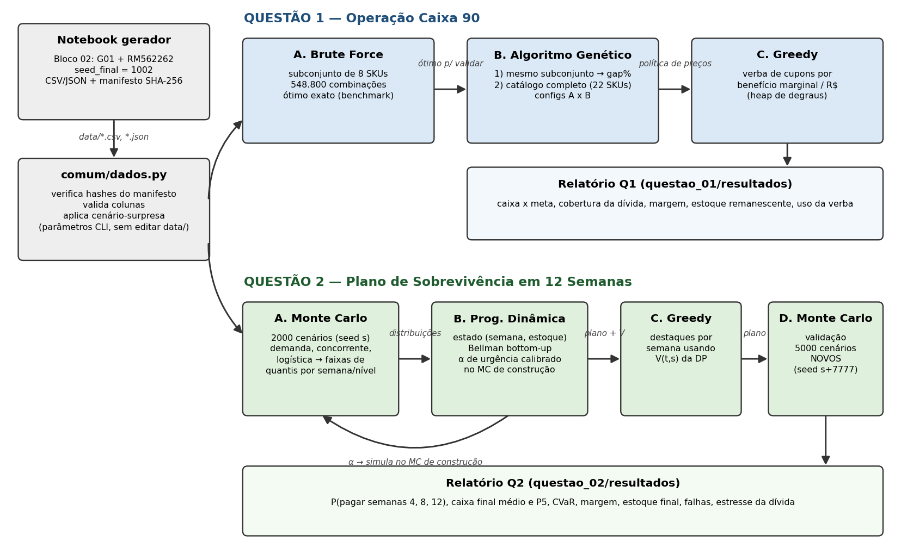

# Checkpoint 6 — Recuperação financeira de varejistas por precificação online

FIAP · Dynamic Programming · Prof. André Marques · Outubro de 2026

## Identificação da instância

| Campo | Valor |
|---|---|
| **Grupo** | **G01** |
| Integrante | Lucas Branquinho — **RM 562262** (2ESPH) |
| **Seed base** | **2** (último dígito de 562262) |
| **Seed final** | **1002** (= 1000 × 1 + 2) |
| **ID da instância** | **`68f24f945556`** |
| SHA-256 do conjunto | `68f24f94555686d87d61ea8d66d6027923c99ecde8be330e4d15ae075952de55` |

Os dados foram gerados pelo notebook oficial ([gerador/Gerador_Inputs_Checkpoint_6.ipynb](gerador/Gerador_Inputs_Checkpoint_6.ipynb)), com **apenas o Bloco 02 alterado**. Os arquivos em [data/](data/) não foram editados. Cada execução confere os hashes do [manifesto](data/manifesto_dados.json) e para se algo foi modificado.

## Como executar

Ambiente usado: Python 3.13.1 no Windows 10. As dependências estão em [requirements.txt](requirements.txt).

```bash
pip install -r requirements.txt
```

```bash
python questao_01/main.py --seed 1002 --modo completo
```

```bash
python questao_02/main.py --seed 1002 --cenarios 5000
```

```bash
python -m pytest
```

Medições de desempenho (opcional, cerca de 10 s cada):

```bash
python questao_01/benchmark.py
```

```bash
python questao_02/benchmark.py
```

Sem `--seed`, os dois `main.py` usam a `seed_final` do config (1002). A mesma seed reproduz exatamente os mesmos números: todos os geradores aleatórios usam `np.random.default_rng(seed)`.

### Cenário-surpresa: tudo por parâmetro, sem editar código

| Alteração pedida | Comando |
|---|---|
| meta de caixa +10% | `python questao_01/main.py --meta-mult 1.10` |
| custo logístico +15% | `python questao_01/main.py --logistica-mult 1.15` · `python questao_02/main.py --logistica-mult 1.15` |
| orçamento promocional −25% | `--orcamento-mult 0.75` (nas duas questões) |
| um SKU deixa de estar disponível | `--remover-sku Q1-016` ou `--remover-sku Q2-009` |
| GA com outra população ou mutação | `python questao_01/main.py --ga-pop 40 --ga-mutacao 0.05` (também `--ga-geracoes`) |
| concorrente reduz preço em 8% | `python questao_02/main.py --concorrente-mult 0.92` |
| dívidas +10% | `python questao_02/main.py --dividas-mult 1.10` |
| outros | `--margem-minima`, `--max-frac-desconto`, `--demanda-mult`, `--uplift-destaque`, `--max-destaques`, `--subconjunto`, `--cenarios-construcao`, `--saida` |

Os resultados desses cenários já executados estão em `questao_0X/resultados/cenarios/`, e a análise está em [docs/decisoes.md](docs/decisoes.md#5-interpretação-financeira).

## Arquitetura



```
comum/          leitura dos dados, verificação SHA-256, medição de tempo e memória
questao_01/     modelo.py · brute_force.py · genetic_algorithm.py · greedy.py · main.py · benchmark.py
questao_02/     modelo.py · monte_carlo.py · dynamic_programming.py · greedy.py · main.py · benchmark.py
tests/          36 testes (pytest)
docs/           complexidade.md · desempenho.md · decisoes.md · arquitetura.png
```

---

## Questão 1: Operação Caixa 90

**Nesta questão utilizamos 3 algoritmos: Brute Force, Algoritmo Genético e Greedy.** Eles formam uma cadeia:

1. **Brute Force:** enumera todas as 548.800 combinações de preço permitidas para um subconjunto de 8 SKUs e encontra o ótimo exato.
2. **Algoritmo Genético:** roda no **mesmo subconjunto**. O gap em relação ao ótimo do BF (0,00% nas 10 execuções) valida o GA. Em seguida, o GA validado roda no catálogo completo (22 SKUs ativos, 3,2·10¹³ combinações), onde o BF seria inviável.
3. **Greedy:** recebe a **política de preços do GA** e distribui a verba de cupons pelos SKUs com maior benefício marginal por real investido.

**Modelo:**

- Demanda com elasticidade (mais forte para aumentos de preço), canibalização dentro da categoria e limite de estoque.
- Piso de margem de 8,72%: 8 SKUs que não o respeitam em nenhum nível são suspensos.
- No máximo 40% dos SKUs com desconto.
- Perda por obsolescência para o estoque velho que sobrar.

Os detalhes e as justificativas estão em [docs/decisoes.md](docs/decisoes.md).

### Resultado final (`questao_01/resultados/resumo.json`)

| Indicador | Valor |
|---|---:|
| Caixa com os preços atuais | R$ 387.103,90 |
| Caixa após o GA | R$ 441.981,34 |
| **Caixa final (após o Greedy)** | **R$ 483.682,41** |
| Meta de caixa 90d | R$ 316.890,90: **atingida, folga de R$ 166.791,51** |
| Cobertura da dívida de 90 dias (R$ 298.427,33) | **162,1%** |
| Margem de contribuição | 22,7% |
| Estoque remanescente | 773 unid. (23,2%), R$ 593.960 a custo (a maior parte nos 8 SKUs suspensos) |
| Verba promocional usada | R$ 110.347,36 de R$ 110.938,27 (99,5%) |

### Evidências da Q1

| Evidência exigida | Arquivo | Produzido por |
|---|---|---|
| Tabela Brute Force × GA no subconjunto | [bf_vs_ga_subconjunto.csv](questao_01/resultados/bf_vs_ga_subconjunto.csv) | `main.executar()` → `brute_force.brute_force()` + `genetic_algorithm.algoritmo_genetico()` |
| Gráfico de fitness por geração | [ga_fitness_por_geracao.png](questao_01/resultados/ga_fitness_por_geracao.png) | `main.executar()` (históricos de `ResultadoGA`) |
| Comparação de duas configurações do GA | [ga_configuracoes.csv](questao_01/resultados/ga_configuracoes.csv), [resumo](questao_01/resultados/ga_configuracoes_resumo.csv) | `CONFIG_A` × `CONFIG_B` em `genetic_algorithm.py` |
| Tabela antes/depois do Greedy | [greedy_antes_depois.csv](questao_01/resultados/greedy_antes_depois.csv) | `greedy.alocar_incentivos()` |
| Política final por SKU | [politica_final.csv](questao_01/resultados/politica_final.csv) | `main.executar()` |
| Big O (3 algoritmos) | [docs/complexidade.md](docs/complexidade.md#questão-1) | — |
| `perf_counter` + `tracemalloc` | [desempenho_escala.csv](questao_01/resultados/desempenho_escala.csv) | `comum/medicao.medir()`, `questao_01/benchmark.py` |
| Otimização antes/depois | [otimizacao_antes_depois.csv](questao_01/resultados/otimizacao_antes_depois.csv) | `brute_force_ingenuo` × `brute_force`, `fitness_ingenuo` × `fitness` |

---

## Questão 2: Plano de Sobrevivência em 12 Semanas

**Nesta questão utilizamos 3 algoritmos: Monte Carlo, Programação Dinâmica e Greedy.** O Monte Carlo aparece duas vezes:

1. **Monte Carlo (construção, 2.000 cenários):** simula três fontes de incerteza (demanda, preço do concorrente e custo logístico). Para cada SKU, semana e nível de preço, a distribuição da demanda é resumida em 10 faixas de quantis.
2. **Programação Dinâmica:** usa essas faixas como distribuição de probabilidade. O estado é **(semana, estoque restante)**, a decisão é o nível de preço ou PAUSAR, e a recursão de Bellman é resolvida Bottom-Up. A DP devolve uma tabela de política `k*(t, s)` e a função de valor `V(t, s)`. O peso de urgência de caixa (α = 0,5) foi calibrado simulando cada α no MC de construção.
3. **Greedy:** recebe o **plano da DP** (estoque e preço esperados por semana) e o `V` da DP. Com isso, escolhe a cada semana os SKUs que recebem os 6 destaques promocionais, pelo critério de benefício por real.
4. **Monte Carlo (validação, 5.000 cenários novos, seed 8779):** simula o plano completo em malha fechada (o preço reage ao estoque realizado) e mede a probabilidade de pagar as dívidas das semanas 4, 8 e 12.

### Resultado final (`questao_02/resultados/resumo.json`, validação com 5.000 cenários)

| Indicador | Preço fixo 1.00 | DP sem destaques | **DP + Greedy (plano final)** |
|---|---:|---:|---:|
| P(pagar semana 4: R$ 87.273) | 100% | 100% | **100%** |
| P(pagar semana 8: R$ 112.728) | 100% | 100% | **100%** |
| P(pagar semana 12: R$ 163.637) | 100% | 100% | **100%** |
| Risco de falha (limite de 10%) | 0% | 0% | **0%** |
| Caixa final médio | R$ 73.923 | R$ 209.023 | **R$ 217.009** |
| Caixa final P5 (VaR 95%, percentil escolhido) | R$ 59.360 | R$ 188.810 | **R$ 199.051** |
| CVaR 5% | R$ 55.326 | R$ 182.524 | **R$ 193.013** |
| Margem de contribuição | 19,1% | 26,7% | **26,1%** |
| Estoque final (unid. de 4.569) | 656 | 722 | **686** |
| Dívida suportável com risco ≤ 10% | ×1,170 | ×1,530 | **×1,555** |

**Cenários de falha:** nenhum no cenário base (0 de 5.000). No estresse com dívida ×1,55, há 286 falhas, todas na semana 12. Esses cenários tiveram demanda média 5,9% abaixo dos cenários bem-sucedidos e logística 2,7% mais cara. Em cenários adversos (sem o SKU Q2-009, ou concorrente −8% com logística +15% e dívidas +10%), o **preço fixo viola o limite de risco** (86% e 56% de chance de pagar), enquanto o plano DP + Greedy mantém 100%. Veja [docs/decisoes.md](docs/decisoes.md#questão-2-rede-novachance).

### Evidências da Q2

| Evidência exigida | Arquivo | Produzido por |
|---|---|---|
| Diagrama MC → DP → Greedy → MC | [docs/arquitetura.png](docs/arquitetura.png) | `docs/gerar_arquitetura.py` |
| Estimativas do Monte Carlo por nível | [mc_estatisticas_por_nivel.csv](questao_02/resultados/mc_estatisticas_por_nivel.csv) | `monte_carlo.estimar_estatisticas()` |
| Calibração de α | [calibracao_alpha.csv](questao_02/resultados/calibracao_alpha.csv) | `main.executar()` |
| Trajetória ótima reconstruída (todos os SKUs) | [dp_trajetoria_precos_estoque.csv](questao_02/resultados/dp_trajetoria_precos_estoque.csv) | `dynamic_programming.trajetoria_esperada()` |
| Trajetória de preço e estoque (representativos) | [trajetorias_representativas.png](questao_02/resultados/trajetorias_representativas.png) | `main.executar()` |
| Destaques escolhidos pelo Greedy | [greedy_destaques.csv](questao_02/resultados/greedy_destaques.csv) | `greedy.alocar_destaques()` |
| Distribuição do caixa final | [distribuicao_caixa_final.png](questao_02/resultados/distribuicao_caixa_final.png), [evolucao_caixa.png](questao_02/resultados/evolucao_caixa.png) | `monte_carlo.simular()` |
| Probabilidade de pagar cada compromisso | [validacao_comparativo.csv](questao_02/resultados/validacao_comparativo.csv) | `monte_carlo.simular()` (`ResultadoSimulacao.prob_pagamento`) |
| Estresse da dívida | [estresse_dividas.csv](questao_02/resultados/estresse_dividas.csv), [png](questao_02/resultados/estresse_dividas.png) | `main.executar()` |
| Big O (MC, DP, Greedy) | [docs/complexidade.md](docs/complexidade.md#questão-2) | — |
| Escalabilidade (8, 16 e 24 SKUs; estoque ×2 e ×4) | [desempenho_escala.csv](questao_02/resultados/desempenho_escala.csv), [png](questao_02/resultados/desempenho_escala.png) | `questao_02/benchmark.py` |
| Reutilização de subproblemas e otimização da DP | [otimizacao_dp.csv](questao_02/resultados/otimizacao_dp.csv) | `resolver_sku_top_down` (`lru_cache`) × `resolver_sku` |

---

## Testes e reprodutibilidade

`python -m pytest` roda 36 testes em cerca de 1,5 s:

- **Dados:** integridade SHA-256, colunas, SKU inexistente.
- **Q1:** fitness vetorizado igual ao ingênuo, BF igual ao BF ingênuo, GA atinge o ótimo do BF em instância pequena, GA reproduzível por seed, histórico monotônico, Greedy respeita o orçamento, entradas inválidas.
- **Q2:** MC reproduzível e com seeds de construção e validação diferentes, choques de média 1, **DP Bottom-Up igual à Top-Down com reuso de subproblemas**, DP não vende com prejuízo, conservação de caixa e estoque na simulação, Greedy respeita orçamento e vagas, dívida fora do horizonte.

## Documentação

- [docs/decisoes.md](docs/decisoes.md): modelagem, parâmetros do GA, ajustes feitos após a validação e interpretação financeira.
- [docs/complexidade.md](docs/complexidade.md): Big O de tempo e memória com variáveis, trecho dominante e limite de viabilidade.
- [docs/desempenho.md](docs/desempenho.md): medições reais (pequena, média e grande) e otimizações antes/depois.
- [IA_USO.md](IA_USO.md): registro do uso de IA generativa.
